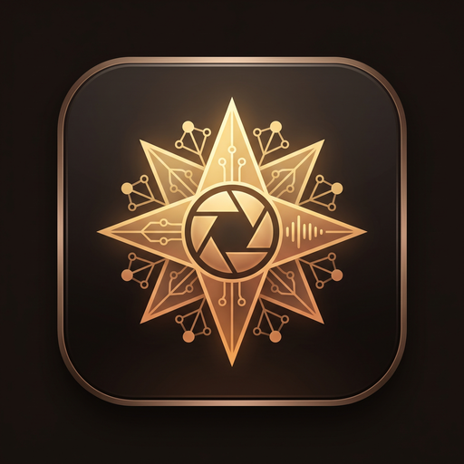

<p align="center">
  
</p>

# Zorya (Зоря)

> *Зоря — a deusa eslava da aurora que abre as portas para o sol nascente.*

Zorya é uma usina de IA local em Rust puro. Detecta automaticamente o hardware disponível, carrega modelos GGUF nativamente e serve uma API compatível com OpenAI — sem Ollama, sem Docker, sem dependências externas.

Parte do [Ecossistema Mriya](https://espectroipe.com.br) · Desenvolvido por [Pedro Luís Tenório](https://github.com/pedro-almeida)

---

## O que o Zorya faz

- **Inferência local** — carrega modelos `.gguf` diretamente na GPU/CPU, sem intermediários
- **API OpenAI-compatible** — qualquer cliente que fala com o ChatGPT fala com o Zorya
- **Servidor MCP** — o Antigravity e o Claude Code usam o Zorya como ferramenta de processamento
- **Suíte ArtCraft** — denoise clássico de imagens, geração de SVG, normalização de áudio EBU R128, extração de PDF
- **Rede de nós** — doa poder computacional para outros usuários do Svitlo silenciosamente
- **Systray** — ícone beija-flor na bandeja indica o estado em tempo real

---

## Início rápido

```bash
# Linux / macOS
git clone https://github.com/pedro-almeida/zorya
cd zorya
cargo run --release

# Windows (PowerShell)
git clone https://github.com/pedro-almeida/zorya
cd zorya
cargo run --release --features cuda
```

Zorya detecta o hardware automaticamente e sobe na porta `8085`:

```
ZORYA v3.0 — SOVEREIGN RUST DAEMON
Node:    usina-zorya
Profile: NitroGtx1650 (Backend: Cuda)
CPU:     AMD Ryzen 7 4800H (16 cores)
GPU:     NVIDIA GeForce GTX 1650 (4096 MB VRAM)
Listening on: http://0.0.0.0:8085
```

Verificar:

```bash
curl http://localhost:8085/health
# {"status":"ok","online":true,"node":"usina-zorya","version":"3.0.0"}
```

---

## Hardware suportado

| Hardware | Backend | Feature flag |
|---|---|---|
| NVIDIA (CUDA) | cuBLAS | `--features cuda` |
| AMD / Intel (Vulkan) | wgpu | `--features vulkan` |
| CPU (qualquer) | AVX2/AVX512 | padrão |
| RAM como VRAM | llama.cpp offload | automático |

O Zorya usa RAM + VRAM combinados. Com 32GB de RAM e GTX 1650 (4GB VRAM), roda o Qwen 2.5 32B com contexto de 32K tokens.

---

## Modelos recomendados

| Hardware | Modelo | Contexto |
|---|---|---|
| GTX 1650 + 32GB RAM | `qwen2.5-coder:32b` | 32K |
| VPS (4GB RAM, CPU) | `qwen2.5-coder:1.5b` | 4K |
| Qualquer | `qwen2.5-coder:7b` | 8K |

Coloque os arquivos `.gguf` em `models/` ou use o Ollama — o Zorya detecta automaticamente.

---

## Endpoints

| Método | Rota | Descrição |
|---|---|---|
| `GET` | `/health` | Status, hardware e versão |
| `POST` | `/v1/chat/completions` | Inferência (OpenAI-compatible) |
| `GET` | `/v1/models` | Modelos disponíveis |
| `GET` | `/api/v1/system/info` | Telemetria detalhada |
| `POST` | `/api/v1/svitlo/generate` | Geração de cards de estudo |
| `POST` | `/api/v1/image/denoise` | Denoise clássico (bilateral, Wiener, unsharp) |
| `POST` | `/api/v1/vector/diagram` | Geração de SVG via VectorCraft |
| `POST` | `/api/v1/audio/master` | Normalização EBU R128 via SoundCraft |
| `POST` | `/api/v1/pdf/extract` | Extração de texto via PdfCraft |
| `POST` | `/api/v1/voice/clone` | Clonagem de voz (TTS) |
| `GET` | `/mcp/sse` | Servidor MCP via SSE |

---

## MCP — Usar o Zorya como ferramenta no Antigravity / Claude Code

```bash
# Registrar no Claude Code
claude mcp add zorya -- /caminho/para/zorya-cli mcp

# Ou via SSE
# Adicionar http://localhost:8085/mcp/sse nas configurações do cliente MCP
```

Ferramentas expostas via MCP:

- `zorya_chat` — inferência de texto
- `zorya_extract_pdf` — extrai texto de PDF
- `zorya_generate_svg` — gera SVG vetorial
- `zorya_denoise` — denoise clássico de imagem
- `zorya_normalize_audio` — normalização EBU R128
- `zorya_clone_voice` — síntese de voz com timbre clonado
- `zorya_system_info` — hardware, modelos e status

---

## Configuração (zorya.toml)

```toml
[node]
name = "usina-zorya"
role = "nitro"          # nitro | vps | mobile
port = 8085

[inference]
model_dir = "models/"
default_model = "qwen2.5-coder-32b-q4_k_m.gguf"
ctx_size = 32768
n_gpu_layers = 999      # -1 = auto
threads = 0             # 0 = todos os cores

[network]
tailscale_auto_detect = true
vps_ip = "143.95.223.218"
vps_zorya_port = 8085

[mcp]
enabled = true
stdio = true
sse_path = "/mcp/sse"
```

---

## Ícone da bandeja (Systray)

O beija-flor na bandeja do sistema indica o estado em tempo real:

| Estado | Cor | Animação |
|---|---|---|
| Offline | Cinza `#4B4B4B` | Nenhuma |
| Ocioso | Verde `#10b981` 40% | Estático |
| IA Ativa | Verde `#10b981` | Halo pulsante branco→dourado, 800ms |
| Rede Ativa | Âmbar `#f59e0b` | Pisca 120ms ON / 80ms OFF |

---

## Integração com o Svitlo

O Svitlo detecta automaticamente se o Zorya está rodando localmente:

1. Tenta `http://localhost:8085/health` (timeout 1s)
2. Se online → fala direto com o Zorya, sem passar pela VPS
3. Se offline → VPS verifica se há algum nó Zorya disponível na rede
4. Fallback → modelos de nuvem (Groq, Gemini)

Usuários que instalam o Zorya e ativam a doação contribuem com poder computacional para outros estudantes da rede automaticamente.

---

## Deploy na VPS (Mini Zorya)

```bash
git clone https://github.com/pedro-almeida/zorya
cd zorya
bash scripts/install-linux.sh
systemctl status zorya
```

O Mini Zorya na VPS usa CPU apenas e roda modelos leves (1.5B-3B). Quando o Zorya do Nitro está online, a VPS delega automaticamente as tarefas pesadas para ele.

---

## Licença

MIT OR Apache-2.0 · Copyright (c) 2026 Pedro Luís Tenório Rocha de Almeida · [Espectro Ipê Soluções Tecnológicas](https://espectroipe.com.br)